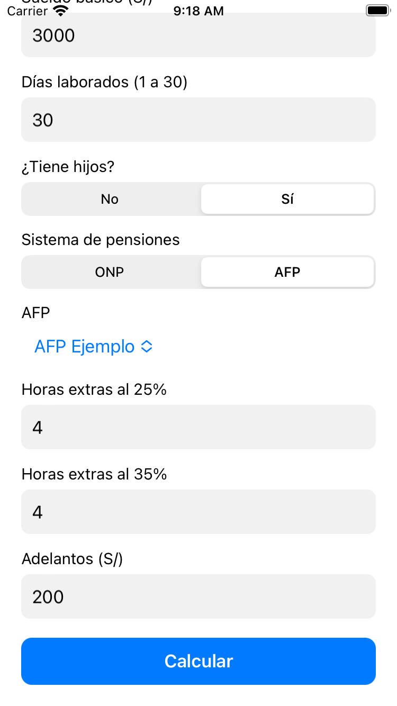
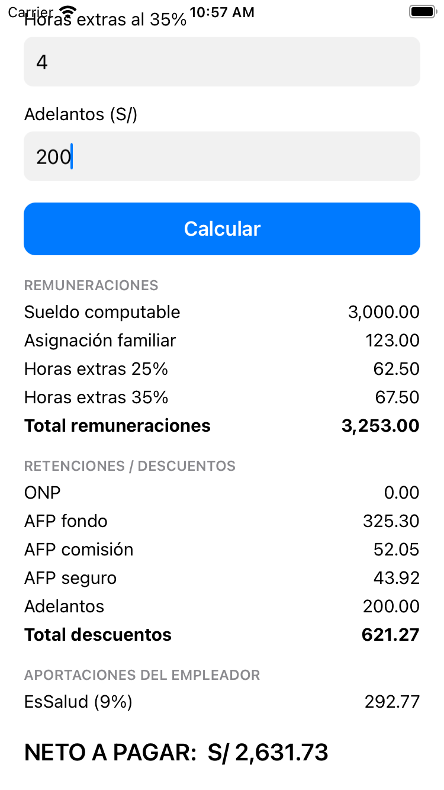

# SEMANA09 · Boleta de pago: del sueldo al neto

App SwiftUI de una sola pantalla que calcula una boleta de pago peruana, más un
libro de Excel que explica cada fórmula y valida el cálculo de la app.

La boleta es el documento donde el empleador muestra cuánto gana el trabajador,
cuánto se le descuenta y cuánto recibe. Su formato está previsto en el artículo
19 del D.S. 001-98-TR y tiene tres bloques: **Remuneraciones**, **Retenciones /
Descuentos** y **Aportaciones del empleador**, además del **Neto a pagar**.

> Boleta de ejemplo. Trabajador y empresa son ficticios; no se usan DNI ni RUC reales.

## Entregables

| Entregable | Archivo |
|---|---|
| Aplicación móvil | `Lab09-BoletaPago/` (proyecto Xcode, SwiftUI) |
| Hoja de Excel | `Boleta_Pago.xlsx` (4 hojas con fórmulas visibles) |
| Pruebas de consola | `pruebas/main.swift` (los 4 casos del enunciado) |
| Contexto y convenciones | `CLAUDE.md` |

## Capturas

| Formulario | Boleta calculada |
|---|---|
|  |  |

Simulador: iPhone SE (3.ª generación), iOS 16.2.

## Cómo correr la app

Requiere **Xcode 14.2** (macOS 12.5 o posterior). El proyecto apunta a iOS 16.0.

```
open Lab09-BoletaPago/Lab09-BoletaPago.xcodeproj
```

Seleccionar el simulador iPhone SE (3.ª generación) y pulsar Run.

## Cómo correr las pruebas del motor

Los archivos `Parametros.swift`, `Modelo.swift` y `Boleta.swift` solo importan
`Foundation`, así que el cálculo se puede verificar sin abrir Xcode:

```
swiftc -O -o /tmp/pruebas-boleta \
  fuente/Parametros.swift fuente/Modelo.swift fuente/Boleta.swift \
  pruebas/main.swift && /tmp/pruebas-boleta
```

Imprime los 4 casos, las validaciones y las respuestas de análisis. Termina en
`TODAS LAS PRUEBAS PASARON` si el motor está correcto.

## Arquitectura

El cálculo está separado de la pantalla, como pide el enunciado:

| Archivo | Responsabilidad |
|---|---|
| `Parametros.swift` | RMV, tasas ONP/AFP/EsSalud, recargos. Diccionario de AFP |
| `Modelo.swift` | `DatosEntrada`, `Concepto`, `ResultadoBoleta` |
| `Boleta.swift` | `class Boleta`: `validar()` y `calcular()` |
| `ContentView.swift` | Pantalla única: formulario, botón Calcular, boleta |

`ContentView` no hace ninguna operación aritmética: lee los campos, llama a
`Boleta.calcular()` y pinta el resultado. Por eso la app y el Excel pueden
coincidir al centavo.

Controles usados, solo los autorizados: `Text`, `VStack`, `HStack`, `@State`,
`TextField`, `Picker`, `Button` y `ScrollView`.

## Reglas de cálculo

| Concepto | Cómo se calcula |
|---|---|
| Sueldo computable | Sueldo básico ÷ 30 × días laborados |
| Asignación familiar | 10% de la RMV si tiene hijos. No se prorratea por días |
| Valor hora | Sueldo básico ÷ 30 ÷ 8 |
| Horas extras 25% | Valor hora × 1.25 × horas |
| Horas extras 35% | Valor hora × 1.35 × horas |
| Total remuneraciones | Suma de los conceptos anteriores |
| ONP | 13% del total de remuneraciones |
| AFP | Fondo 10%, comisión 1.60% y seguro 1.35% del total |
| Adelantos | Monto ingresado, se resta tal cual |
| Total descuentos | Pensión (ONP o AFP) + adelantos |
| Neto a pagar | Total remuneraciones − total descuentos |
| EsSalud | 9% del total. Lo paga el empleador, no se descuenta al trabajador |

Convenciones para que app y Excel coincidan: cada concepto se redondea a 2
decimales con medio hacia arriba y luego se suman; los intermedios (valor hora,
sueldo diario) van sin redondear; el valor hora sale del sueldo básico, no del
computable. En Swift se usa `Decimal` y en Excel `ROUND(...; 2)`.

## Control cruzado

App y Excel dan el mismo resultado al centavo en los cuatro casos. La hoja
`Casos` tiene una fila **Diferencia** que debe mostrar `0.00`.

| | Caso 1 | Caso 2 | Caso 3 | Caso 4 |
|---|---|---|---|---|
| Entrada | 2,500 / 30d / sin hijos / ONP | 1,800 / 27d / con hijos / ONP | 3,000 / 30d / con hijos / AFP / 4h+4h / adel. 200 | 4,200 / 24d / con hijos / AFP / 2h+2h / adel. 100 |
| Total remuneraciones | 2,500.00 | 1,743.00 | 3,253.00 | 3,574.00 |
| Total descuentos | 325.00 | 226.59 | 621.27 | 562.83 |
| **Neto a pagar** | **2,175.00** | **1,516.41** | **2,631.73** | **3,011.17** |
| EsSalud (empleador) | 225.00 | 156.87 | 292.77 | 321.66 |

Los casos 1, 2 y 3 coinciden con la respuesta publicada en el enunciado. El
caso 4 no trae respuesta oficial: lo evalúa el docente.

## Tabla de fuentes

| Dato | Valor | Fuente | Fecha de consulta |
|---|---|---|---|
| RMV | S/ 1,230.00 | D.S. de la RMV, vigente desde el 01/10/2026 | 29/10/2026 |
| Asignación familiar | 10% de la RMV = S/ 123.00 | Ley 25129 | 29/10/2026 |
| ONP | 13% | D.L. 19990 | 29/10/2026 |
| EsSalud | 9% | Ley 26790 | 29/10/2026 |
| Recargo horas extras | 25% las primeras, 35% las siguientes | Normas de jornada y sobretiempo | 29/10/2026 |
| AFP Ejemplo | Fondo 10.00%, comisión 1.60%, seguro 1.35% | Valores de prueba del enunciado. Con datos reales, usar los de la SBS | 29/10/2026 |

## Preguntas de análisis

Las respuestas están desarrolladas en la hoja **Explicacion** del libro de
Excel. Resumen:

1. **ONP o AFP.** En el caso 3 la AFP deja S/ 1.62 más este mes (2,631.73 contra
   2,630.11), porque sus tres tasas suman 12.95% contra el 13% de la ONP.
   Comparar porcentajes no basta: el 10% del fondo AFP va a la cuenta individual
   del trabajador, mientras comisión y seguro son costo puro; la ONP es un fondo
   común que exige 20 años de aportes para dar pensión.
2. **Costo real para la empresa.** El caso 3 le cuesta al empleador S/ 3,545.77
   (3,253.00 + 292.77 de EsSalud). Al trabajador le llega el 74.22% como neto.
3. **Días laborados.** En el caso 2, con 30 días el neto sería 1,673.01 contra
   1,516.41. La diferencia bruta es 180.00 y la neta 156.60: exactamente el 87%,
   porque la ONP retiene el 13% de ese incremento.
4. **Horas extras.** En el caso 3 representan 130.00 de 3,253.00, el 4.00%.
5. **Con datos reales.** Cada integrante arma la boleta de un sueldo tomado de
   una oferta laboral publicada, en la hoja `Casos`.

## Hoja de Excel

| Hoja | Contenido |
|---|---|
| `Parametros` | RMV, tasas, factores y convenciones, con fuente y fecha |
| `Boleta` | Datos de entrada y los 10 conceptos con fórmulas visibles |
| `Casos` | Los 4 casos, el control cruzado y el caso propio de cada alumno |
| `Explicacion` | Cada fórmula en palabras con ejemplo numérico, y las 5 respuestas |

Ningún porcentaje está escrito dentro de una fórmula: todas las hojas apuntan a
las celdas de `Parametros`.

## Alcance

Cubre los niveles 1 y 2 del enunciado. No se calcula la retención de renta de
5.ª categoría ni se consideran faltas aparte: las faltas ya están reflejadas en
los días laborados. EsSalud se calcula sobre el total de remuneraciones, sin
bases mínimas.
